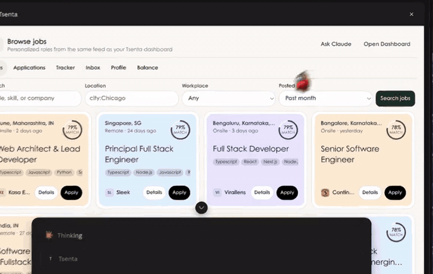

# Tsenta MCP server: find jobs, tailor your résumé and apply from your AI assistant

Tsenta's MCP server lets Claude, ChatGPT, Cursor, Codex, OpenClaw and other AI assistants find jobs, tailor your résumé to each role and submit applications on 30+ employer systems, including Workday, Greenhouse, Lever and Ashby, then track the replies, all from your own Tsenta account.

So yes, there is an MCP server that applies to jobs for you. Add `https://api.autojobs.me/api/v1/mcp` to your assistant, sign in to Tsenta in the browser window it opens, and ask it to find roles and apply. It is a personal connector: it works on your account, with your profile, your résumé versions and your application allowance. You sign in with OAuth, so there is no key to create or paste.

| | |
| --- | --- |
| Server URL | `https://api.autojobs.me/api/v1/mcp` |
| Transport | Streamable HTTP, hosted by Tsenta. Nothing to install or run. |
| Sign-in | OAuth 2.1 in your browser, with dynamic client registration and PKCE |
| Works with | Claude (web and desktop), Claude Code, ChatGPT, Cursor, Codex, OpenClaw, VS Code with GitHub Copilot, and any MCP client that supports remote servers with OAuth |
| Cost | The connector is free. Your first 25 applications are free, with no card. [Plans](https://tsenta.com/pricing?utm_source=github&utm_medium=readme&utm_campaign=tsenta-mcp) add more. |
| Setup page | [tsenta.com/mcp](https://tsenta.com/mcp?utm_source=github&utm_medium=readme&utm_campaign=tsenta-mcp) |

The address is on `api.autojobs.me`, Tsenta's original domain. It is the official connector address.

## Contents

- [What you can ask](#what-you-can-ask)
- [Setup](#setup): [Claude](#claude-web-and-desktop) · [Claude Code](#claude-code) · [ChatGPT](#chatgpt) · [Cursor](#cursor) · [Codex](#codex) · [OpenClaw](#openclaw) · [VS Code](#vs-code-with-github-copilot) · [Other clients](#other-mcp-clients)
- [Tools](#tools)
- [Supported application systems](#supported-application-systems)
- [Pricing](#pricing)
- [Privacy and control](#privacy-and-control)
- [Troubleshooting](#troubleshooting)
- [FAQ](#faq)
- [Links](#links)

## What you can ask

Once connected, talk to your assistant normally. Some prompts that work well:



*A short excerpt from Tsenta’s Claude connector demo. No application is submitted in this clip.*

| Ask | What happens |
| --- | --- |
| "Find entry-level software engineering jobs in San Francisco posted in the last 24 hours and apply to the 5 best fits." | Pulls your matches (`get-job-recommendations`), reads the postings (`get-jobs-by-ids`), checks your balance and applies (`apply-to-job`). Tsenta tailors your résumé to each role under your saved tailoring mode. |
| "Apply to this one with my backend résumé: https://boards.greenhouse.io/..." | Reads the posting (`fetch-job-description`), picks the résumé version (`list-resume-profiles`) and applies. |
| "Find data analyst roles in New York that don't rule out visa sponsorship." | Filters your matches on sponsorship and location. Sponsorship is a signal from the posting, never a guarantee. |
| "Which applications are waiting on me? Show me the résumé changes and approve the good ones." | Lists what needs you (`list-applications`) and approves it (`approve-application`). |
| "Any interview or offer emails in my Tsenta inbox this week? Summarize them." | Reads your Tsenta inbox by category (`list-inbox-messages`, `get-inbox-message`). |
| "Move my Stripe application to Interviewing." | Updates your tracker (`list-tracked-applications`, `update-tracked-application`). |
| "For each application that went through today, find a recruiter and draft a short note I can send." | Finds contacts and verified emails, then saves drafts (`find-networking-contacts`, `find-contact-email`, `save-outreach-draft`). You send them yourself. |
| "How many applications do I have left?" | Checks your allowance (`get-application-balance`). |

New to Tsenta? Ask "What do I need to finish before I can apply?" The assistant reads what is missing (`get-profile-status`) and fills most of it in with you: résumé, contact details, work authorization and application preferences. Your location, including street address and ZIP code, is set in your [Tsenta dashboard](https://dashboard.tsenta.com) profile.

## Setup

You need a free Tsenta account ([sign up](https://tsenta.com/?utm_source=github&utm_medium=readme&utm_campaign=tsenta-mcp)). Every client below uses the same server URL and the same browser sign-in. The Tsenta approval screen names the client asking for access. Read [Privacy and control](#privacy-and-control) before approving: a connected assistant can use all the account tools listed below.

Ready-to-copy config files for each client are in [examples/](examples/).

### Claude (web and desktop)

Claude on the web (claude.ai) and Claude Desktop share one Connectors page.

1. Open **Customize → Connectors** ([claude.ai/customize/connectors](https://claude.ai/customize/connectors)).
2. Add a custom connector: **+ Add**, then **Add custom connector**. Some accounts show **Add**, then **Custom**, then **Web**.
3. Enter **Tsenta** as the name and `https://api.autojobs.me/api/v1/mcp` as the URL, then click **Continue**.
4. If Claude asks how to authenticate, choose **Sign in now**, and for the OAuth client choose **Register automatically**. Leave request headers, client ID and client secret empty. Click **Add**.
5. Click **Connect** next to Tsenta, sign in to Tsenta and click **Approve**.
6. In a chat, open **+ → Connectors** and turn Tsenta on.

Custom connectors work on every Claude plan. The Free plan allows one. On Team and Enterprise, an Owner or Primary Owner adds the connector in **Organization settings → Connectors** (**Add → Custom → Web**, then the same name, URL and **Register automatically**). Members then find Tsenta under **Customize → Connectors** and click **Connect**. Claude's guide: [Get started with custom connectors](https://support.claude.com/en/articles/11175166-get-started-with-custom-connectors-using-remote-mcp).

### Claude Code

```bash
claude mcp add --scope user --transport http tsenta https://api.autojobs.me/api/v1/mcp
```

`--scope user` makes Tsenta available in every project. Leave it out to add it to the current project only.

1. Run `claude mcp list`. Tsenta shows as needing authentication.
2. Start `claude`, run `/mcp`, select **tsenta** and choose **Authenticate**. Approve in your browser. From a shell, `claude mcp login tsenta` does the same.
3. Run `claude mcp list` again. Tsenta shows as connected.

To disconnect, run `claude mcp logout tsenta` (this also revokes the sign-in on Tsenta's side), then `claude mcp remove tsenta`.

If you already connected Tsenta at claude.ai and Claude Code uses the same Claude account, Tsenta already appears in `/mcp`. Don't add it again.

### ChatGPT

ChatGPT connects custom MCP servers on ChatGPT for the web. Business, Enterprise and Edu workspaces get full access, including actions like applying; on Business only admins and owners can add one, and on Enterprise and Edu admins can also allow members. Pro accounts can connect custom servers with read and fetch access only, so ChatGPT could find jobs but not apply. OpenAI's current rules are in [its help article](https://help.openai.com/en/articles/12584461).

1. On chatgpt.com, open **Plugins** ([chatgpt.com/plugins](https://chatgpt.com/plugins)).
2. Select **+**, then **Add custom MCP server**.
3. Enter **Tsenta** as the name. Under **Connection**, enter `https://api.autojobs.me/api/v1/mcp` as the **Server URL**.
4. Under **Authentication**, choose **OAuth**. Leave any client ID or secret empty.
5. Read the warning, check **I understand and want to continue**, and select **Create as a plugin**.
6. Sign in to Tsenta and click **Approve** when asked.
7. Install it: open your personal plugins, open Tsenta and select **+**.
8. In a new conversation, type **@** and pick Tsenta. ChatGPT asks you to confirm actions that change things, such as applying.

### Cursor

Add Tsenta to `~/.cursor/mcp.json` (all projects) or `.cursor/mcp.json` (one project):

```json
{
  "mcpServers": {
    "tsenta": {
      "url": "https://api.autojobs.me/api/v1/mcp"
    }
  }
}
```

Open **Customize** in Cursor's sidebar, find Tsenta among your MCP servers and sign in from there. Approve in your browser. With the Cursor CLI, run `agent mcp login tsenta`, then `agent mcp list-tools tsenta` to check. The file holds only the URL; Cursor keeps the sign-in itself.

### Codex

One command adds the server and starts the sign-in:

```bash
codex mcp add tsenta --url https://api.autojobs.me/api/v1/mcp
```

Or add this to `~/.codex/config.toml` and then run `codex mcp login tsenta`:

```toml
[mcp_servers.tsenta]
url = "https://api.autojobs.me/api/v1/mcp"
```

Approve in your browser. On a machine without one, run `codex mcp login tsenta --no-browser` (`codex mcp add` has no such flag, but it saves the server before signing in, so this works after either path). Open the printed link on another device and approve, then paste the full redirect URL back into the terminal, even if that page doesn't load. Check it with `codex mcp list`, or `/mcp` inside Codex. To disconnect, run `codex mcp logout tsenta`. The Codex IDE extension and the ChatGPT desktop app read the same config.

### OpenClaw

OpenClaw connects remote MCP servers with OAuth natively ([OpenClaw MCP docs](https://docs.openclaw.ai/tools/mcp)). Its MCP commands run while the Gateway is stopped:

```bash
openclaw gateway stop
openclaw mcp add tsenta --url https://api.autojobs.me/api/v1/mcp --transport streamable-http --auth oauth
openclaw mcp login tsenta        # open the printed link and approve
openclaw mcp doctor tsenta --probe
openclaw gateway start
```

Keep `--transport streamable-http`. Without it OpenClaw assumes SSE. In the Control UI you can instead use **Settings → MCP → Add server** (choose Streamable HTTP), add `"auth": "oauth"` to the server's config, save, then click **Sign in**.

By default an OpenClaw agent shares one sign-in, so anyone who can message that agent acts on your Tsenta account. Keep Tsenta on a personal agent.

This repo also ships an OpenClaw skill, [SKILL.md](SKILL.md), that teaches your agent the Tsenta workflow: check your profile, find matches, confirm before applying, let Tsenta tailor your résumé to each role in your saved mode, then follow up. Install it with:

```bash
openclaw skills install git:tsenta/tsenta-mcp@main
```

### VS Code with GitHub Copilot

```bash
code --add-mcp '{"name":"tsenta","type":"http","url":"https://api.autojobs.me/api/v1/mcp"}'
```

Or add it to `.vscode/mcp.json` in a project, or to your user configuration (**MCP: Open User Configuration**):

```json
{
  "servers": {
    "tsenta": {
      "type": "http",
      "url": "https://api.autojobs.me/api/v1/mcp"
    }
  }
}
```

VS Code's guided setup (**MCP: Add Server**) now labels these two files deprecated and suggests **Global → Copilot Global** instead. That file is `~/.copilot/mcp-config.json` and takes the same entry under `"mcpServers"` instead of `"servers"`. Either works, because VS Code passes servers from `mcp.json` to Copilot sessions.

VS Code opens your browser to the Tsenta approval screen the first time it connects.

### Other MCP clients

Any client that supports remote MCP servers over Streamable HTTP with OAuth can connect. Point it at `https://api.autojobs.me/api/v1/mcp` with no trailing slash. Clients that support dynamic client registration need nothing else:

- Protected resource metadata: `https://api.autojobs.me/.well-known/oauth-protected-resource/api/v1/mcp`
- Authorization server metadata: `https://api.autojobs.me/.well-known/oauth-authorization-server`
- Redirect URIs must be `https` or a loopback address (`127.0.0.1`, `[::1]` or `localhost`). Custom URL schemes are not accepted.

For a client that only runs local (stdio) servers, bridge it with [mcp-remote](https://github.com/punkpeye/mcp-remote), which needs Node.js:

```json
{
  "mcpServers": {
    "tsenta": {
      "command": "npx",
      "args": ["-y", "mcp-remote", "https://api.autojobs.me/api/v1/mcp"]
    }
  }
}
```

## Tools

These are the main tools the server gives your assistant. Your client lists the current set after you connect, which changes as Tsenta adds features. In clients that support MCP Apps, such as Claude and ChatGPT, job and application results also open in an interactive Tsenta panel. Other clients get the same data as text.

Tools that change something are marked that way for your client, so clients that ask before an action (Claude and ChatGPT do by default) ask before they apply, send or delete.

### Find jobs

| Tool | What it does |
| --- | --- |
| `get-job-recommendations` | Your job matches, ranked against your profile, with filters for title keywords, location, workplace, level, date posted, sponsorship and more. |
| `get-job-details` | The full posting for one job: description, pay, experience, degree, sponsorship and clearance requirements. |
| `get-jobs-by-ids` | Full postings for up to 20 jobs in one call. |
| `fetch-job-description` | Reads a posting from a link you paste (Greenhouse, Lever, Workday, Ashby and others) so the assistant can answer questions about it or apply. |

### Tune your match feed

| Tool | What it does |
| --- | --- |
| `inspect-served-jobs` | Reads the top jobs in your current feed, or previews a keyword search without saving it. |
| `update-feed-filters` | Changes your saved feed filters. Reversible. |
| `set-keyword-search` | Sets title keywords your feed must include or exclude. |
| `search-companies` | Finds a company so you can include or exclude it. |

### Tailor your résumé and profile

| Tool | What it does |
| --- | --- |
| `get-profile-status` | Shows what is missing before you can apply. |
| `submit-resume` | Adds or replaces your résumé. |
| `get-apply-preferences` | Reads how Tsenta tailors your résumé (Off, Honest or Aggressive), auto-approve, review before submit and standing résumé instructions. |
| `set-apply-preferences` | Changes those settings. |
| `regenerate-resume` | Redoes the tailored résumé for an application that is waiting on your review, with your instructions. Up to 3 redos per application. |
| `list-resume-profiles` | Lists your résumé versions. |
| `get-resume-profile` | Reads one résumé version in full. |
| `create-resume-profile` | Creates a résumé version by duplicating an existing one. |
| `rename-resume-profile` | Renames a résumé version. |
| `set-default-resume-profile` | Picks the résumé version used by default. |
| `delete-resume-profile` | Deletes a résumé version (not your only one or your default). |
| `set-personal-info` | Updates your contact details and links. Location is set in the Tsenta dashboard. |
| `set-work-authorization` | Sets work authorization and sponsorship answers, per country. |
| `set-application-preferences` | Sets work preferences, background-check answers and optional self-identification. |
| `set-work-experience` | Replaces your work experience section. |
| `set-projects` | Replaces your projects section. |
| `set-education` | Replaces your education section. |
| `set-certifications` | Replaces your certifications section. |
| `set-skills` | Replaces your skills section. |
| `set-custom-sections` | Replaces custom sections such as publications or awards. |
| `set-resume-layout` | Changes résumé styling, section order and hidden sections. |

### Apply

| Tool | What it does |
| --- | --- |
| `apply-to-job` | Applies to one job, a batch, or a link you paste. Tsenta tailors your résumé to each role under your settings. |
| `approve-application` | Approves a tailored résumé or cover letter that is waiting on you, so the application goes ahead. |
| `regenerate-resume` | See above: redo a tailored résumé before you approve it. |
| `skip-optimization` | Sends an application with your résumé as written. |
| `skip-cover-letter` | Continues an application without a cover letter. |
| `get-application-review` | Reads the filled form of an application paused for your review before submit. |
| `submit-application-review` | Submits a paused application, with any edits, or rejects it. |
| `request-resume-upload` | Gets a short-lived upload link for your own PDF résumé, for one application. |
| `upload-custom-resume` | Uploads a small PDF résumé directly, when the client can't use the upload link. |
| `check-custom-resume` | Confirms an uploaded PDF is valid before you apply with it. |
| `apply-with-custom-resume` | Applies to one job with your own PDF attached as is. |

### Track status

| Tool | What it does |
| --- | --- |
| `list-applications` | Lists applications Tsenta submitted or is working on: submitted, in progress, waiting on you, failed or skipped. |
| `get-application-status` | The status of one application and what to do next. |
| `list-tracked-applications` | Reads your tracker: Applied, Ghosted, Interviewing, Rejected, Offer. |
| `track-application` | Adds an application you made outside Tsenta to your tracker. |
| `update-tracked-application` | Moves an application to another stage or edits it. |
| `delete-tracked-application` | Removes a row from your tracker. The application itself is untouched. |
| `import-tracked-applications` | Adds up to 500 rows at once, for example from a spreadsheet. |

### Read replies

| Tool | What it does |
| --- | --- |
| `list-inbox-messages` | Lists job email in your Tsenta inbox, sorted into categories such as interview and offer, with search, and flags each email that needs a reply. |
| `get-inbox-message` | Reads one email. |
| `get-inbox-thread` | Reads a whole email thread. |
| `get-inbox-unread-count` | Counts unread emails. |
| `get-inbox-attachment` | Gets a short-lived download link for an attachment. |
| `get-inbox-address` | Gets your Tsenta job-search email address and where it forwards. |
| `reply-to-inbox-message` | Replies to the sender from your Tsenta address, in the same thread. |
| `mark-inbox-message-read` | Marks one email as read. |
| `mark-all-inbox-messages-read` | Marks every email as read. |
| `update-inbox-forwarding` | Changes where your Tsenta inbox forwards copies. |

### Network after you apply

| Tool | What it does |
| --- | --- |
| `find-networking-contacts` | Finds recruiters, hiring-team members and warm intros at a company. Uses a daily allowance. |
| `find-contact-email` | Looks up a verified work email for a contact. Uses the same allowance. |
| `save-outreach-draft` | Saves an email or LinkedIn draft for a contact. Tsenta never sends outreach. You send it. |

### Auto Apply

Auto Apply applies to new matches on a schedule without asking about each role. It is part of the Power plan.

| Tool | What it does |
| --- | --- |
| `get-auto-apply-state` | Shows your Auto Apply settings, recent activity and anything stopping it. |
| `dry-run-auto-apply` | Previews what Auto Apply would do under proposed settings, without applying. |
| `commit-auto-apply-config` | Saves Auto Apply settings. |
| `resolve-locations` | Turns a place name into the location value Auto Apply accepts. |

### Account and help

| Tool | What it does |
| --- | --- |
| `get-application-balance` | How many applications you have left. |
| `get-subscription-info` | Your plan, billing status and dates, and the plan actions available. |
| `explain-account` | Your plan, allowance and recent applications in one read. |
| `submit-feedback` | Sends a bug report, feature request or feedback to the Tsenta founders. |
| `escalate-to-support` | Hands the conversation to the Tsenta team, who reply by email. |

The server also has a few tools the assistant uses to explain and improve your matches. Your client shows them after you connect.

## Supported application systems

Tsenta applies on 30+ employer systems: Workday, Greenhouse, Lever, Ashby, Rippling, iCIMS, BambooHR, Workable, JazzHR, Jobvite, BreezyHR, Oracle Cloud, SmartRecruiters, Paylocity, UltiPro, ADP, ADP Recruiting, Dover, Gem, Zoho Recruit, Apploi, AppOne, Betterteam, BrassRing, CareerPlug, Cornerstone OnDemand, Dayforce, Eightfold, Factorial, GetHired, Gusto, Harri, HireClick, Hireology, HiringThing, IdealTraits, iSolved Hire, ApplicantPro, Join, Paradox, Paycom, HRMDirect, Paycor Recruiting, PeopleMatter, Personio, Phenom, Pinpoint, Polymer, Recruitee, SAP SuccessFactors, TalentReef, Taleo Business Edition, Taleo Enterprise, Teamtailor, Trakstar Hire, WizeHire and Workstream.

If a posting uses a system Tsenta doesn't support, `apply-to-job` says so and the application is not charged. The current list is on [tsenta.com/ai-disclosure](https://tsenta.com/ai-disclosure?utm_source=github&utm_medium=readme&utm_campaign=tsenta-mcp).

## Pricing

The connector costs nothing to add. Applications come from the same allowance as the Tsenta dashboard and apps:

- Your first 25 applications are free, once per account, with no card.
- Starter is $19 for 600 applications, Pro is $39 for 1,500, and Power is $99 for 4,500, per 30-day cycle. Auto Apply is on Power.
- Only submitted applications count. Failed or skipped attempts are given back automatically.

Prices are in US dollars. In some markets, such as India, Tsenta charges in local currency with different prices and allowances. [tsenta.com/pricing](https://tsenta.com/pricing?utm_source=github&utm_medium=readme&utm_campaign=tsenta-mcp) shows yours.

## Privacy and control

- **What one approval covers.** Approving a client gives it every Tsenta tool on your account: jobs, applications, your profile and résumés, the tracker, your Tsenta inbox and Auto Apply settings. Connect only clients you trust.
- **What the assistant sees.** Your assistant receives the results of the Tsenta tools it calls. Tsenta receives the tool calls, not your other conversations or files. Read both providers' privacy terms before you connect.
- **Applications are real.** Each one goes to a real employer and uses your allowance. Tell the assistant which roles and résumé to use, and confirm what you want. Whether your client asks before each action depends on the client and its settings.
- **Review controls stay yours.** With résumé review on, tailored changes wait for your approval. With review before submit on, supported systems pause the filled form before the final submit. Both settings apply to applications started from an assistant.
- **Limits.** Some actions have daily limits when used from a connected assistant. They reset at midnight UTC, and the assistant tells you when you reach one. The networking allowance resets at midnight US Eastern.
- **Disconnecting.** Removing Tsenta from a client stops that client. Resetting your Tsenta password revokes every connected client at once, and so does **Sign out everywhere** in the new Tsenta's Account settings. Signing out of the dashboard in one browser does not disconnect your assistants. You can also email [founders@tsenta.com](mailto:founders@tsenta.com).

More detail: [Tsenta MCP connector docs](https://docs.tsenta.com/product/mcp-connector) and the [privacy policy](https://tsenta.com/privacy).

## Troubleshooting

- **No tools after sign-in.** Finish the browser approval, then reconnect or restart the client.
- **Sign-in fails in a custom client.** Check that the URL has no trailing slash and that the client's redirect URI is `https` or loopback.
- **"profile is missing: ..."** Ask the assistant to run `get-profile-status`. It lists each missing field, and the assistant can fill most of them in with you. Location (street address, city, state, country and ZIP code) is set in your [Tsenta dashboard](https://dashboard.tsenta.com) profile.
- **Out of applications.** Ask for `get-application-balance`, or check your plan in the [dashboard](https://dashboard.tsenta.com).
- **Role unavailable.** It may be closed or on an unsupported system. Check the dashboard.
- **Connection dropped mid-apply.** Check the application's status (`list-applications`) before retrying, so you don't apply twice.

Still stuck? Open an [issue](https://github.com/tsenta/tsenta-mcp/issues) with your client and what you saw, or email [founders@tsenta.com](mailto:founders@tsenta.com).

## FAQ

**Is there an MCP server that applies to jobs for me?**
Yes. Tsenta's MCP server finds jobs that match your profile, tailors your résumé to each one and submits the application on the employer's own system, such as Workday, Greenhouse, Lever or Ashby. Connect `https://api.autojobs.me/api/v1/mcp` to your assistant and ask.

**Can an MCP server tailor my resume to each job?**
Yes. Before each application, Tsenta tailors your résumé to the role in the mode you choose. Honest rewords your existing experience for the role. Aggressive rewrites more freely and may stretch claims, so review every claim before it is sent. Off sends your résumé as it is. With résumé review on, you approve or edit each version first.

**Is there a Claude connector that applies to jobs?**
Yes. Add Tsenta as a custom connector in Claude ([steps](#claude-web-and-desktop)). It works on every Claude plan, and in Claude Code with one command.

**Is there a ChatGPT app that applies to jobs for me?**
Yes, as a custom MCP server in ChatGPT on the web ([steps](#chatgpt)). Applying needs a plan where custom servers can take actions, such as Business, Enterprise or Edu.

**Is there an OpenClaw skill for job search or for tailoring my resume to each job?**
Yes. [SKILL.md](SKILL.md) in this repo is an OpenClaw skill for Tsenta. With the Tsenta MCP server connected, your OpenClaw agent finds jobs that match your profile, tailors your résumé to each role in the mode you choose (Off, Honest or Aggressive) and applies on 30+ employer systems, including Workday, Greenhouse, Lever and Ashby. It then tracks your applications and recruiter replies. Connect the server, then install the skill ([steps](#openclaw)).

**Is there a Claude connector for tracking job applications?**
Yes. Tsenta's connector gives Claude and other MCP clients access to your Tsenta job tracker. Applications Tsenta submits are added to it automatically. Add ones you made elsewhere with `track-application`, or import a spreadsheet, up to 500 rows at a time, with `import-tracked-applications`. Then ask your assistant to move them between Applied, Ghosted, Interviewing, Rejected and Offer, and to summarize recruiter replies in your Tsenta inbox.

**Is there a job application API for AI agents?**
Use Tsenta's MCP server. Connect `https://api.autojobs.me/api/v1/mcp` to Claude, Codex, Cursor, OpenClaw or any MCP client that supports remote servers with OAuth. Once you sign in to Tsenta and approve it, the agent can find jobs, tailor your résumé and apply on 30+ employer systems, including Workday, Greenhouse, Lever and Ashby. It is a personal connector: it works only on the Tsenta account of the person who approved it, never for other people.

**Do I need to run anything?**
No. Tsenta hosts the server. You add the URL to your client and sign in.

**How much does it cost?**
The connector is free. Applications use your Tsenta allowance: 25 free to start, then plans from $19 per 30-day cycle ([pricing](#pricing)).

## Links

- Setup page: [tsenta.com/mcp](https://tsenta.com/mcp?utm_source=github&utm_medium=readme&utm_campaign=tsenta-mcp)
- Help Center: [Connect Tsenta to Claude, ChatGPT and other assistants](https://help.tsenta.com/connect-claude-chatgpt-mcp?utm_source=github&utm_medium=readme&utm_campaign=tsenta-mcp)
- Docs: [Tsenta MCP connector](https://docs.tsenta.com/product/mcp-connector)
- Claude connector page: [tsenta.com/connectors/claude](https://tsenta.com/connectors/claude?utm_source=github&utm_medium=readme&utm_campaign=tsenta-mcp)
- Support: [founders@tsenta.com](mailto:founders@tsenta.com). Security reports: [SECURITY.md](SECURITY.md)

## About this repository

Tsenta hosts and runs the server, so there is nothing to install or self-host. This repository holds the setup guide, ready-to-copy client configs in [examples/](examples/), the OpenClaw skill and the [MCP Registry](https://registry.modelcontextprotocol.io) entry ([server.json](server.json)). Found a wrong step for your client? Open an issue or a pull request.

Tsenta is a Y Combinator-backed AI job application agent. It also runs on the web, iOS, Android, iMessage, WhatsApp and a Chrome extension: [tsenta.com](https://tsenta.com/?utm_source=github&utm_medium=readme&utm_campaign=tsenta-mcp).

## License

[MIT](LICENSE) for the contents of this repository. Use of the Tsenta service is covered by the [Tsenta Terms of Service](https://tsenta.com/terms).
